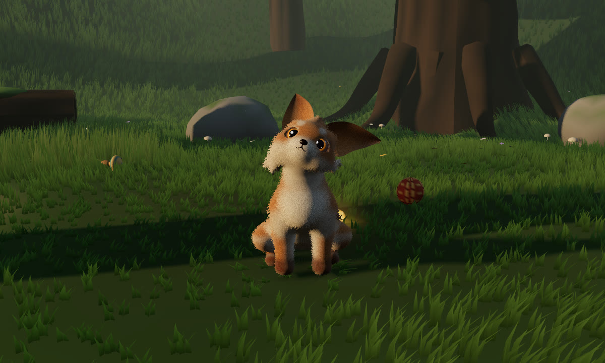
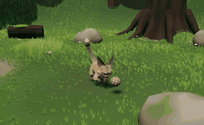

# Kinling

A small original creature with a mind of its own, living in a sheltered glade in your browser.

A kinling is a soft, big-eared animal with a glowing seed-lantern at the end of its tail. It gets hungry, thirsty, tired, bored and lonely; it notices things, makes up its own mind, and remembers what happened. Two kinlings from different seeds behave differently, and the same one is recognisably itself when you come back.





The kinling shares its glade with a robin and a pond frog. The models, animation and kinling voice are procedural. Real bird and frog recordings ship with the game and play locally.

## Run it

Requires Node 20 or newer.

```bash
npm install
npm run dev        # http://localhost:5173
```

| Command | What it does |
| --- | --- |
| `npm run dev` | Development server |
| `npm run build` | Typecheck and production build into `dist/` |
| `npm run preview` | Serve the production build |
| `npm test` | Simulation scenario tests (Vitest, headless, about 5 s) |
| `npm run typecheck` | TypeScript only |
| `npm run test:browser` | Drives the built app in headless Chrome (run `npm run build` first; needs Chrome, set `CHROME=/path/to/chrome` if it is not at `/usr/bin/google-chrome`) |

## Meeting your kinling

Watch first. In the opening minute it notices the toys lying in the glade and decides how to approach them: a bold one trots straight over, a cautious one circles and stretches its neck, a timid one sits and watches. After a few seconds you are invited to name it.

| You do | With |
| --- | --- |
| Look around | Drag the ground · scroll or pinch to zoom · arrow keys, `+` `−` |
| Stroke it | Drag slowly across its fur. Where you stroke matters, and each kinling has a favourite spot. (`P` gives one gentle stroke from the keyboard.) |
| Poke it | A quick tap. It may take that as an invitation, or not. |
| Feed it | **Berry** (`2`), then click the ground |
| Throw a toy | **Ball** (`3`) or **Rattle** (`4`), then click where it should land. Or drag a toy with the hand and flick. |
| Lead a wisp | **Wisp** (`5`): a mote of light follows your pointer for it to stalk and pounce on |
| Show it something new | **Curio** (`6`), then click the ground. It hums, spins or chimes. |
| Call it | **Call** (`C`): a whistle. It may come, come later, or decline. |
| Teach it | **Sit** (`S`). It has no idea what this means at first. Reward it (a stroke or a berry) whenever it sits and the cue becomes reliable. |

Choose **Robin** to watch it forage. Scatter seeds to earn its trust, then whistle from its perch for a reply. After three meals it will fly over to an awake kinling. At night it stays on its perch unless invited down.

Choose **Frog** and **Start chorus** to play a memory game. Watch the flowers light up as the frog jumps. Repeat the trail by tapping the floating pads, using their named buttons or pressing `1`, `2`, `3`. Trails grow from two to six hops. The best trail and the robin's trust carry over to the next visit.

Choose **Kinling** to return to your companion. **Spin** (`T`) gives the twirl cue. A well-timed stroke reinforces a successful turn. The journal tracks progress on the trick.

It does plenty unprompted: forages, drinks at the pond, naps where it feels comfortable, plays alone, brings you a toy, asks for company.

The top-left plate gives a one-line reading; click it for a plain-language journal. Sound, reduced motion, detail level, save export/import and "start over" are under the gear. `` ` `` opens the developer inspector.

Progress is saved in this browser (`localStorage`). Nothing runs while the page is closed; when you return, the time away is estimated once (capped at 12 hours of effect) and applied.

## How it works

- **Three.js** renders the body and world. The creature is sculpted at startup from an implicit surface, skinned automatically, covered in shell fur, and animated entirely procedurally (planted-foot gait with IK, look-at, verlet tail and ears).
- **Yuka** is the agent infrastructure: a `Vehicle` owns movement, `Vision` and `MemorySystem` give it perception that differs from world truth, `Think` with custom `GoalEvaluator`s chooses intentions, `CompositeGoal`s carry them out, a `StateMachine` owns the body's mode, plus steering, A* on a nav graph, triggers, telegrams and fuzzy appraisal.
- **Custom systems** supply needs, affect, seeded personality, episodic memory and the learning rules.

See [docs/ARCHITECTURE.md](docs/ARCHITECTURE.md) for the module map, the Yuka feature decisions, and an exact description of what is learned and how. [docs/CHECKLIST.md](docs/CHECKLIST.md) tracks the brief against the implementation, and [docs/VERIFICATION.md](docs/VERIFICATION.md) records what was tested and what was not.

## Project layout

```
src/
  core/        maths, seeded RNG, noise, fixed-step accumulator
  sim/         the simulation (no rendering imports): terrain, nav, entities, needs,
               affect, identity, learning, memory, save, offline, world
  sim/creature Kinling (movement owner), senses, brain (Think), goals, body states
  render/      stage, sky, environment, props, camera
  render/creature  sculpt (sdf, anatomy, build), materials, rig (animation)
  audio/       Web Audio engine and wildlife recordings
  input/       pointer and touch gestures
  ui/          HUD, journal, developer inspector
  app/         wiring and the main loop
tests/         scenario tests
scripts/       browser checks, deterministic capture, screenshots
```

## Limitations

Read [docs/VERIFICATION.md](docs/VERIFICATION.md) before trusting any claim here. In short: behaviour is covered by automated tests and the app was driven in headless Chrome, but it was developed without a GPU or speakers, so real-hardware frame rate, the feel of the animation in motion, and how the audio sounds have not been checked by a person.

The game code is MIT licensed. The following audio excerpts and their adaptations are distributed under [CC BY-SA 4.0](https://creativecommons.org/licenses/by-sa/4.0/).

- European robin recorded by Lawrence Shove, Devon, 1961. © The British Library Board, W1CDR0001425 BD16. Three excerpts, mixed to mono, trimmed, faded and level-adjusted. [Original recording](https://commons.wikimedia.org/wiki/File:European_Robin_%28Erithacus_rubecula%29_%28W1CDR0001425_BD16%29.ogg)
- Single Frog Croak by MichaeltheFox8621. One croak mixed to mono, trimmed, faded, level-adjusted and converted to WAV. [Original recording](https://commons.wikimedia.org/wiki/File:Single_Frog_Croak.oga)
